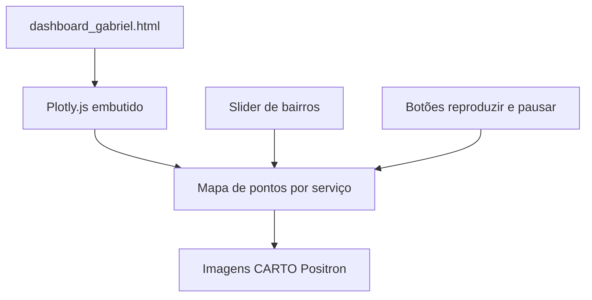

# Localização das Empresas em Recife

Mapa interativo das empresas do Recife, por bairro e por tipo de serviço, em um único arquivo HTML gerado com Plotly.

## Contexto

O repositório publica um dashboard geográfico da cidade do Recife. O gráfico se chama **Localização das Empresas** e mostra pontos no mapa agrupados pela legenda **Serviços**. O script ou notebook que montou a figura não está neste repositório. O que está versionado é o HTML exportado.

## O que o dashboard faz

- Desenha um mapa `scattermapbox` centralizado em Recife, no estilo `carto-positron`.
- Separa os pontos em 27 categorias de serviço. Cada categoria é uma camada do mapa, da conservação e limpeza a saúde, educação, comércio e outros grupos.
- Filtra a visualização por bairro. O controle deslizante usa o prefixo `Bairro=` e lista 93 bairros. A vista inicial é COHAB.
- Inclui botões de reproduzir e pausar para percorrer os bairros.
- No hover de cada ponto aparecem o serviço, o bairro, a latitude e a longitude.

O arquivo não cita a base de dados. Também não traz CNPJ, razão social nem contato dos estabelecimentos.

## Stack

- HTML estático
- Plotly.js 2.24.1, embutido no arquivo (exportação offline do Plotly)
- Mapa base CARTO Positron. As imagens do mapa são carregadas pela internet
- Trecho do Hotjar no `<head>`, incluído para coletar feedback de uso

Não há backend, não há instalação de Python ou Node e não há variável de ambiente para abrir o dashboard.

## Visão geral



## Como abrir localmente

Não existe arquivo `.env`. O `.gitignore` já cobre `.env`, credenciais JSON e chaves, para o caso de um script de geração ser adicionado depois.

1. Clone o repositório.
2. Abra `dashboard_gabriel.html` no navegador.
3. Use uma conexão com a internet para carregar o mapa base. O JavaScript do Plotly já vem dentro do HTML.

A aba do navegador fica com o título **Localização das Empresas em Recife**. O arquivo tem cerca de 19 MB porque a biblioteca do Plotly está embutida.

## Estrutura

```text
.
├── dashboard_gabriel.html
├── .gitignore
└── README.md
```

## Próximos passos possíveis

- Versionar o script ou notebook que gera o HTML, hoje ausente.
- Citar no gráfico a base de dados usada. O HTML atual não traz essa referência.
- Reduzir o tamanho do arquivo apontando o Plotly para um CDN, se a abertura offline deixar de ser necessária.
- Decidir se o trecho do Hotjar continua útil num repositório de portfólio.
